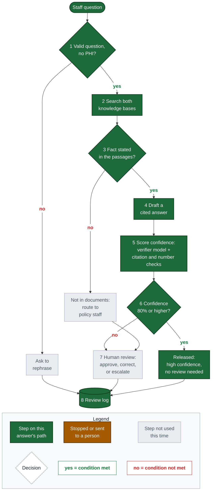

# ALPHIN Policy Workflow (Open WebUI Pipe + Review Actions)

A visible, auditable workflow built entirely inside stock Open WebUI **v0.12.5**. Select the model **ALPHIN - Policy Workflow (Pipe + Review Actions)**, ask a policy question, and the workflow runs fixed steps in code. Each step shows live status, and the answer ends with a trace table, a confidence score and a diagram of the path taken. The diagram has its own **legend**: green = step on this answer's path, amber = stopped or sent to a person, grey = step not used; decisions are **diamonds**; **yes** labels are green and **no** labels red. It is laid out top to bottom with large text so it stays readable in the chat column.

**Confidence-based review (October 29, instructor feedback):** only answers whose confidence is below the threshold (80% by default) go to human review. Confidence is the verifier model's probability that the answer is fully supported by the retrieved passages and answers the question asked, read from its token probabilities; a failed citation or number check caps it at 40%. See [Confidence routing](#confidence-routing-replaces-auto-clear-october-29).

**Current model choice (October 29):** the untouched base `nemotron-3.5-lightning:30b-a3b-bf16` now drafts the answer as well as gates and verifies evidence. The project owner prioritizes overall correctness over the adapter's latency advantage. The confidence threshold (80% default) replaces the prior exact-quote auto-clear rule. Historical scores below measured the earlier adapter-draft workflow, not this current base-draft configuration; no current comparative accuracy result is claimed.

Static examples of the three main paths (high confidence released, low confidence to review, not in the documents), each with the legend: [path_examples.png](path_examples.png), rebuilt by `render_path_examples.py` from the Pipe's own `mermaid()`.

## The Steps

| # | Step | Where it runs | Failure handling |
|---|---|---|---|
| 1 | Intake: length check and Social Security / recipient-ID screen | code | Asks the user to rephrase; logged as `REPHRASE`; nothing is searched |
| 2 | Search both knowledge bases (Administrative Code, Provider Manual), top 8 passages | Open WebUI retrieval API (Nomic embeddings, Chroma) | Missing knowledge base or retrieval error: stops with an explicit message; logged as `ERROR` |
| 3 | Evidence gate: does a retrieved passage state the specific fact asked for? | base Nemotron, JSON verdict | `INSUFFICIENT` → says the documents do not state it and routes to policy staff (`NO_ANSWER`). If the gate model is unreachable the workflow stops with a service-problem message (it does not pretend the documents lack the answer) |
| 4 | Draft a cited answer | untouched base Nemotron (`nemotron-3.5-lightning:30b-a3b-bf16`), streamed | Failure mid-stream: explicit message; logged as `ERROR` |
| 5 | Confidence score | verifier model (base Nemotron, one YES/NO token with log-probabilities) + coded checks | Confidence = P(YES) that the answer is fully supported and responsive. Every cited `document p. N` must match a retrieved passage and every number must appear in the retrieved text; a failure caps confidence at 40%. If the draft has no Sources list, the passages named by the evidence gate are cited and labelled "added by the workflow". Verifier unavailable: confidence 0, goes to review |
| 6 | Confidence threshold | code (`CONFIDENCE_THRESHOLD`, default 0.80) | At or above: **released without review** (`HIGH_CONFIDENCE`, review status `AUTO_RELEASED`; the buttons still work). Below: low-confidence warning with reasons, goes to step 7 (`LOW_CONFIDENCE`) |
| 7 | Human review (low-confidence and not-in-documents answers) | Action buttons: three coloured icons in the small toolbar under the answer (next to copy/regenerate; name shows on hover): green check **Approve**, amber pencil **Needs correction** (note required), red flag **Escalate to policy staff** (note optional). Every answer that needs review says where they are | Same decision twice does not create a duplicate record |
| 8 | Review log | SQLite `alphin_workflow.db` in the Open WebUI data volume | Type `/log` in the workflow chat to see the latest runs, routes and review decisions |

Routes recorded per run: `HIGH_CONFIDENCE`, `LOW_CONFIDENCE`, `NO_ANSWER`, `REPHRASE`, `ERROR` (runs logged before October 29 evening use the older `VERIFIED`/`FLAGGED`). Each run also logs `confidence` and `verifier_p_yes`. Review status: `AUTO_RELEASED`, `pending`, `APPROVED`, `NEEDS_CORRECTION`, `ESCALATED`, or `n/a` when nothing was answered. Regenerating an answer re-keys to the same message, resets review to pending and records a `regenerated` event.

## Why This Design

- Open WebUI **v0.12.5** (upgraded from v0.12.3 on 2026-10-29; data, users, chats, 2 knowledge bases and 6 models verified intact afterwards). Release-note items this design relies on: [v0.12.4](https://github.com/open-webui/open-webui/releases/tag/v0.12.4) "Faster action buttons" (an Action only re-saves the chat when it changed a message, which ours does only on a real decision) and "Questions survive reconnects" (a function's input dialog, used for the reviewer note, survives a page reload); [v0.12.5](https://github.com/open-webui/open-webui/releases/tag/v0.12.5) number Valves as sliders (our top-k, token and length valves use min/max) and faster knowledge-base commands. Both releases carry security fixes, which is the main reason to be on them.
- Platform features used (present in the v0.12.5 source, verified in the container): Pipe `__event_emitter__` status and source events, Action `__event_call__` input dialog, `chat:message` edits, model `actionIds`, and Mermaid rendering in chat. 0.12.4/0.12.5 added nothing that replaces these.
- Fixed steps in code, not model-chosen tools: originally built to supply passages to the closed-book adapter, the Pipe now supplies them to the untouched base. The explicit retrieval, evidence and review path is retained rather than switching this workflow to Native tool calling.
- The gate and the verification are separate on purpose: the gate prevents answering when the facts are absent; the verification catches answers that cite or quote things the passages do not contain.

## Historical Adapter-Draft Results On The 49 Benchmark Items

Same 49 items and same blinded Claude Sonnet 5.5 judge as the other comparisons (single run, indicative, not sealed):

| Configuration | Answerable correct | Strict pass | Unanswerable declined | Unsupported-claim outputs | Correct citation (of answered) | Median seconds |
|---|---|---|---|---|---|---|
| Adapter + KBs (Legacy, no workflow) | 30/40 | 28/40 | 2/9 | 19/49 | 6/40 | 30.5 |
| **ALPHIN Policy Workflow (adapter draft; historical)** | **33/40** | 26/40 | **3/9** | **16/49** | **34/37** | **8.4** |

Routing: of 34 answers shown as `VERIFIED`, 21 passed strictly and 12 contained an unsupported claim; 8 were `FLAGGED` (3 contained unsupported claims) and 7 were `NO_ANSWER`. Of the 9 unanswerable items, 4 were declined by the gate and 3 more were flagged, so 7 of 9 were not shown as verified; 2 were shown as verified and were wrong. The gate also wrongly declined 3 answerable items.

Read this honestly: the workflow does **not** raise strict accuracy (26/40 vs 28/40; the difference is not significant at n=40). Its gains are structural: a visible path, near-complete citations in the text (34 of 37 answered vs 6 of 40), a 3.6x lower median latency, and a decline/flag route that catches 7 of 9 unanswerable questions that otherwise receive confident answers. It still passes 12 unsupported-claim answers as `VERIFIED` because the checks are about citations and numbers, not every sentence. Human review exists for that reason.

Evidence: `evaluation/milestone3_kb_comparison/` (`workflow49_run1.json`, `outputs_workflow.jsonl`, `judge_B_scores_workflow.jsonl`, `summary_workflow.json`, `run_workflow49.py`). The gate prompt was written generically and not tuned on benchmark answers, but two benchmark-style questions were used while debugging, so treat the 49 items as no longer clean held-out data.

## Install and Reproduce

`./scripts/apply-config.sh` installs both functions from `config/openwebui/functions/` and the wrapper model `alphin-policy-workflow` (which attaches the review action). The function source is the single copy in the repository. Valves (admin-editable): endpoint, draft model, gate model, knowledge-base names, top-k, question length, answer tokens, and `ENFORCE_GATE` (turn off to compare with/without the gate).

For an **existing installation**, a saved valve overrides the new source default. In **Admin Panel → Functions → ALPHIN Policy Workflow → Valves**, set **Draft Model** to `nemotron-3.5-lightning:30b-a3b-bf16` and Save. Leave the endpoint and every other valve intact. New installations use the base by default. Check step 4 of a fresh answer and its saved `draft_model` to verify the active choice; old chats and benchmark files remain historical. The Mac project instance was changed through this GUI; other installed WebUI instances need their own explicit valve update.

## Demo Script (about 4 minutes)

1. Select the workflow model; click the **Timely filing** suggestion. Watch the step statuses, answer, citation chips, trace table and diagram.
2. Click **Approve**; the status line changes and a toast confirms the log write.
3. Ask the **Not in the documents** suggestion: the gate declines and routes to policy staff (orange path).
4. Click **High confidence** (DME long-term use): confidence about 97%, released without review (green path to *Released*). Then **Low confidence** (DME copayment): about 9%, sent to review; the answer says items of $10 or less are exempt, which the manual does not state.
5. Click the **No review needed** suggestions (a question containing a fake Social Security number, or the too-short question "Help me"). Step 1 stops them, the diagram shows the rephrase path, and the answer ends with "Review status: not needed (nothing was answered)". Rephrase and service errors are not reviewed (nothing was answered); a not-in-documents answer is still routed to policy staff.
6. Type `/log` to show the review log.
7. (Optional) In Admin > Functions, show the Pipe source and valves.

## Limits

- Single-user prototype; the log lives in the Open WebUI data volume and is not exported automatically.
- The review buttons record decisions; they do not send notifications to policy staff.
- The October 29 confidence-routing version was exercised through saved browser chats on the Mac instance and captured in a real Chrome render of Open WebUI v0.12.5 (diagram, legend, colours and status lines).

__CONF__